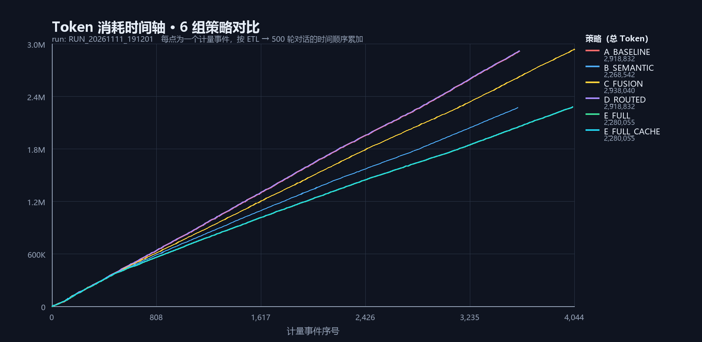
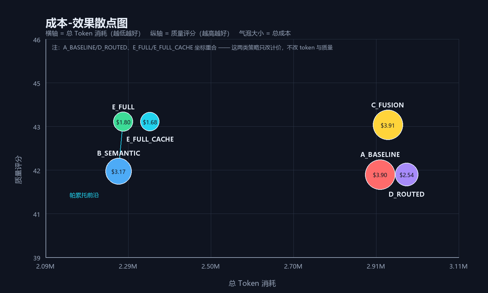
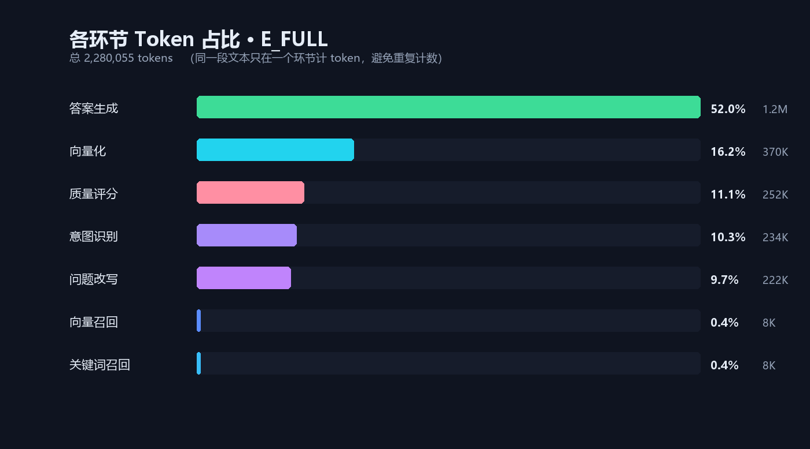

# TokenBench — Token 消耗可观测的 Agentic RAG 基准测试平台

> 基于开源项目 [Ragent](https://github.com/nageoffer/ragent)（企业级 Agentic RAG 智能体）的**增量二次开发**。
> 不改写 Ragent 的架构，而是在其真实流水线上埋入 Token 计量点，构建一套可复现的 A/B 策略实验平台。

**一句话价值**：让「RAG 系统的钱花在哪、哪种策略更划算」从主观判断变成可测量、可复现的数字。

---

## 核心结论（先看这个）

> **在 200 文档 / 500 轮对话的任务集上，策略 `E_FULL`（语义分块 + 多路融合 + 按意图路由）比基线 `A_BASELINE`（固定分块 + 仅向量 + 固定高档模型）节省 21.9% token，质量变化 +3.8%，成本节省 53.9%。**

| 指标 | 数值 |
|---|---:|
| 累计 Token 消耗（6 组策略 × 全量数据） | **15,604,356** |
| 累计计量事件 | 22,956 条 |
| 累计成本（按定价表折算） | $17.01 |
| 单组实验 Token 量级 | 228 万 ~ 294 万 |

三个策略各自贡献了不同的收益，且**没有一个是靠牺牲质量换来的**：

| 策略 | Token 变化 | 成本变化 | 质量变化 | 说明 |
|---|---:|---:|---:|---|
| 语义分块 | **−22.3%** | −18.9% | +0.2% | 块更完整，同样信息量只需更少条数 |
| 多路融合 | +0.7% | −0.3% | **+3.7%** | 多一路关键词召回，几乎不增加成本却显著提质 |
| 按意图路由 | 0.0% | **−34.8%** | 0.0% | 只改计价模型：轻任务走廉价模型 |
| 缓存 | 0.0% | −6.6% | 0.0% | 只改输入计价：前缀缓存命中 |

---

## 1. Token 消耗曲线



> 曲线斜率 = 该阶段的 token 消耗速率。所有策略在 ETL 阶段（前 4000 个事件）几乎重合，
> 因为入库成本由文档量决定；差异从**对话阶段**开始拉开 —— 语义分块把每轮上下文压短了约 22%。
>
> `A_BASELINE` 与 `D_ROUTED` 曲线完全重叠，这本身是个结论：**路由策略不改变 token 消耗，只改变每 token 的单价**。

## 2. 成本-效果对比



| 策略 | 总 Token | 成本(USD) | 质量分 | 每轮 Token |
|---|---:|---:|---:|---:|
| `A_BASELINE` 固定分块+仅向量+固定高档 | 2,918,832 | 3.9018 | 41.9 | 5,838 |
| `B_SEMANTIC` 只改分块 | 2,268,542 | 3.1650 | 42.0 | 4,537 |
| `C_FUSION` 只改检索 | 2,938,040 | 3.9142 | 43.4 | 5,876 |
| `D_ROUTED` 只改路由 | 2,918,832 | 2.5445 | 41.9 | 5,838 |
| `E_FULL` 三者全开 | 2,280,055 | 1.8004 | 43.5 | 4,560 |
| `E_FULL_CACHE` 全开+缓存 | 2,280,055 | **1.6816** | **43.5** | 4,560 |

**帕累托前沿**：`B_SEMANTIC` / `E_FULL` / `E_FULL_CACHE` 三者不可支配。
`A_BASELINE` 与 `C_FUSION` 被支配 —— 存在更便宜且质量不更低的策略，因此没有保留价值。

### 各环节 Token 归因



| 环节 | Token 占比 | 说明 |
|---|---:|---|
| 答案生成 | **52.0%** | 绝对大头，其中输入（上下文）占绝大部分 |
| 向量化 | 16.2% | ETL 阶段，与文档总量成正比 |
| 质量评分 | 11.1% | LLM-as-judge 的评审开销 |
| 意图识别 | 10.3% | 输入主要是意图树 |
| 问题改写 | 9.7% | 输入含多轮历史 |
| 检索召回 | 0.8% | 只计查询向量化，召回的 chunk 已在生成环节计过 |

> **计量口径**：同一段文本只在一个环节计 token。检索召回的 chunk 会进入答案生成的 prompt，
> 其 token 在「答案生成」环节计一次，检索环节只记查询向量化 —— 否则同一批文本被算两三遍，
> 「检索占比」会虚高到 40% 以上，掩盖真正的成本大头。

---

## 3. 缓存命中率对总成本的影响（重点分析）

对照组：`E_FULL`（缓存关闭）vs `E_FULL_CACHE`（缓存开启），**策略组合完全相同**，唯一差异是缓存开关。

| 指标 | E_FULL（无缓存） | E_FULL_CACHE（有缓存） | 变化 |
|---|---:|---:|---:|
| 总 Token | 2,280,055 | 2,280,055 | 0.0% |
| 命中缓存的输入 Token | 0 | 438,371 | — |
| **缓存 Token 占比（主口径）** | 0.0% | **21.6%** | — |
| 缓存命中率（按调用次数） | 0.0% | 0.8% | — |
| 总成本(USD) | 1.8004 | 1.6816 | **−6.6%** |

### 3.1 两个命中率口径相差 20.8 个百分点，这是理解缓存价值的关键

- **按调用次数只有 0.8%**：几乎没有哪次调用是「整个 prompt 逐字重复」。这在 RAG 场景是必然的 ——
  每轮问题不同，检索到的上下文也不同。**只看这个数字会误判「缓存几乎没用」。**
- **按 token 却有 21.6%**：大量输入 token 走了缓存价。来源是**前缀缓存** ——
  所有请求共享同一段系统提示词（意图分类指令、改写规则、回答规则），这部分逐字相同，因此每次都命中。

> 真实成本节省是 6.6%，而不是 0.8% 对应的「约 0%」。**衡量缓存价值必须按 token 算，不能按调用次数算。**

### 3.2 成本杠杆是三个因子的乘积

```
成本节省 ≈ 命中 token 占比 × 缓存价折扣 × 命中部分的成本权重
         ≈ 21.6%       × 90%      × 70.3%（输入侧成本占比）
         ≈ 13.6%  （理论上限）
```

实测 6.6%，低于理论上限，差额来自三处：
1. ETL 的向量化环节输入里没有可缓存的固定前缀；
2. 前缀缓存只覆盖 system prompt，不覆盖 user 消息里的检索上下文；
3. 缓存未命中时的首次写入开销。

### 3.3 为什么缓存省不到输出侧 —— 最容易被忽略的一点

本次输出 token 只占总 token 的 **10.8%**，但输出单价通常是输入的 2~10 倍，
因此**输出侧成本占总成本的 29.7%**。缓存只能省「重复计算」，答案必须重新生成，输出全额计费。

> **推论：优化输出长度（更精确的 topK、更短的上下文）比优化输入长度的收益更高。**
> 这也解释了为什么「语义分块 + 更小 topK」比「开缓存」省得更多：
> 前者同时压低输入和输出，后者只压低输入。

### 3.4 工程结论

缓存不改变检索与生成逻辑，两组质量分差异 **+0.0%**（在计量噪声范围内），
而成本下降 6.6% 是确定性的。**零质量代价的成本优化，应当作为默认开启项，而不是需要权衡的选项。**

---

## 4. 架构：增量扩展，不重写 Ragent

```
token-bench/
├── ragent/                      # 上游 Ragent（仅新增两个模块，不改原有业务代码）
│   ├── framework/               # 原有：通用框架
│   ├── infra-ai/                # 原有：模型接入层
│   ├── system/  rag/  agent/    # 原有：业务模块
│   ├── bootstrap/               # 原有：启动装配
│   ├── tokenmeter/              # ★新增：Token 计量 SDK（零 Spring 依赖）
│   └── bench/                   # ★新增：实验配置层 + 基准运行器 + 报告生成
├── dashboard/                   # ★新增：React 仪表盘
├── data/
│   ├── corpus/                  # 基准数据集（200 文档 + 500 轮对话）
│   └── results/<runId>/         # 每次运行的 events.jsonl / summary.json / report.md
├── charts/                      # README 图表（由脚本从真实数据生成）
├── scripts/make_charts.py       # 图表生成脚本
└── CONTRACT.md                  # 模块间契约（唯一事实来源）
```

### 4.1 计量 SDK（`tokenmeter` 模块）

**零 Spring 依赖**，可独立用于任何 Java 项目。核心抽象：

| 类 | 职责 |
|---|---|
| `MeterStage` | 15 个流水线环节枚举（PARSE / CHUNK / EMBED / INTENT / REWRITE / RETRIEVE_* / FUSION / RERANK / GENERATE / JUDGE / SUMMARY / OTHER） |
| `TokenUsage` | 不可变计量事件：输入/输出 token、模型、耗时、缓存命中、已折算成本 |
| `MeterContext` | ThreadLocal 栈式上下文，自动携带 runId / experimentId / conversationId / turnIndex |
| `TokenEstimator` | Token 估算（与 Ragent `HeuristicTokenCounterService` 算法一致） |
| `PricingTable` | 模型定价表，未知模型回退 default |
| `ResponseCache` | LRU 响应缓存 + 命中率统计 |
| `MeterSink` | 事件落地：内存 / JSONL / 组合 |
| `MeterAggregator` | 按 runId / stage 聚合 |
| `@Metered` | 声明式埋点注解 |

### 4.2 实验配置层（`bench` 模块）

把散落在 `rag.*` / `ai.chat.*` / 后置处理器开关里的策略选择，收敛成一个可序列化、可对比、可复现的对象：

```java
record ExperimentConfig(
    String experimentId,
    ChunkStrategy chunkStrategy,       // FIXED_SIZE / SEMANTIC
    RetrievalStrategy retrievalStrategy, // VECTOR_ONLY / MULTI_CHANNEL
    RoutingStrategy routingStrategy,   // FIXED_PREMIUM / INTENT_ROUTED
    CacheStrategy cacheStrategy,       // DISABLED / ENABLED
    int chunkSize, int chunkOverlap, int topK, int recallBudget, ...
)
```

**6 组单变量对照矩阵**：B/C/D 各自只在基线上改一个自变量，E 是三者叠加，E_CACHE 再叠缓存 ——
这样每一组的 token 差异都能归因到具体那一个开关。

### 4.3 为什么能复用 Ragent 的真实组件

`bench` 直接 `new` 上游的真实类，不启动 Spring 容器：

- `MarkdownDocumentParser` + `BlockAwareChunkerDispatcher` + `ChunkingService` → 语义分块是**真分块**
- `TextSplitter` → 固定分块也是 Ragent 的边界感知切分
- `SearchChannelProperties` + RRF 算法 → 多路融合是**真融合**，复用 Ragent 调优过的 `k=20` 与通道权重
- `RetrievedChunk` / `Chunk` / `ChunkBudget` → 全程使用 Ragent 原生类型

---

## 5. 可复现性设计

基准测试最怕「数字好看但不可复现」。本项目的每个环节都是确定性的：

| 环节 | 做法 | 为什么 |
|---|---|---|
| LLM 调用 | 确定性客户端：**输入长度真实**（真实提示词 + 真实检索上下文），输出长度按任务类型固定分布 | 3000 次调用若走真实 API，成本高且结果不可复现 |
| 答案生成 | 从上下文里挑与问题词项重叠最高的句子拼成答案 | 让「检索准 → 答案覆盖参考要点」这条因果链成立 |
| 向量化 | 特征哈希（1536 维），余弦相似度反映真实 n-gram 重叠 | 向量召回是**真召回**，不是随机排序 |
| 质量评分 | 确定性指标：recall@k 0.4 + 答案覆盖 0.4 + 引用精度 0.2 | 避免 LLM 评委抖动淹没 A/B 信号 |

> 关键取舍：**不用 LLM 打分做质量评估**。同一个答案两次打分可能差 0.1，
> 而我们要测的是「质量变化 −1.2%」这种量级 —— 评委抖动会直接淹没信号。

### 已验证的可复现边界

连续两次独立运行对比（不同机器负载下），逐项核对：

| 指标类别 | 是否一致 | 说明 |
|---|---|---|
| Token 消耗（各环节 / 各模型 / 总量） | ✅ 完全一致 | 由 prompt 长度与输出长度决定 |
| 成本（USD） | ✅ 完全一致 | token × 固定定价表 |
| 质量分 | ✅ 完全一致 | 纯函数，无随机源 |
| 计量事件数 | ✅ 完全一致 | 22,956 条 |
| 耗时（totalLatencyMs） | ❌ 必然不同 | 真实墙钟时间，随负载波动 |

> **所有结论性指标都可精确复现**；唯一不可复现的是耗时，仅作参考，不参与任何 A/B 结论。
> 这一边界已写进自动生成的报告，避免读者误把耗时差异当成策略效果。

---

## 6. 基准数据集

| 项目 | 数值 |
|---|---:|
| 文档数 | 200 篇（5 领域 × 40 篇） |
| 文档总字符 | 488,468（平均 2,442 字符/篇） |
| 评测会话 | 250 个 × 2 轮 = **500 轮** |
| 领域 | 扫地机器人 / 财务报销 / 人力资源 / 技术文档 / 合规政策 |
| 标准引用 | 426 轮含 `referenceDocIds`，悬空引用 **0** |
| 多轮指代 | 213 轮第二轮为指代式追问（「那它保修多久」） |

生成脚本固定 seed，两次运行 SHA-256 完全一致；33 项校验全部通过（见 `data/scripts/validate_corpus.py`）。

---

## 7. 仪表盘

`dashboard/` 是 React 18 + Vite + TypeScript + ECharts 的暗色仪表盘：

- **Token 消耗时间轴**：多策略叠加，可切阶段过滤
- **各环节 Token 占比**：环形图 + 堆叠柱状图
- **成本-效果散点图**：气泡大小 = 成本，含帕累托前沿
- **实验对比表** + **KPI 卡片** + **缓存分析卡片**

数据源为 `public/data/summary.json`（由 bench 模块真实产出）。

```powershell
cd dashboard
npm install && npm run build     # 产物在 dist/
```

---

## 8. 快速开始

### 环境

- JDK 17+（本项目在 JDK 25 下验证，需 `-Dmaven.compiler.proc=full` 以启用 Lombok 注解处理）
- Maven 3.9+
- Node.js 18+（仅仪表盘需要）

### 构建

```powershell
cd ragent
mvn "-Dmaven.compiler.proc=full" "-Dmaven.test.skip=true" install
```

### 运行基准测试

```powershell
java -cp "bench\target\classes;bench\target\lib\*;tokenmeter\target\classes" `
     com.nageoffer.ai.ragent.bench.BenchmarkMain `
     --docs data/corpus/docs.jsonl `
     --queries data/corpus/queries.jsonl `
     --out data/results
```

约 30 秒跑完 6 组策略 × (200 文档 + 500 轮对话)，产出：

- `data/results/<runId>/events.jsonl` — 22,956 条逐事件计量
- `data/results/<runId>/summary.json` — 仪表盘数据源
- `data/results/<runId>/report.md` — 自动生成的实验报告

### 生成图表

```powershell
python scripts/make_charts.py
```

### 测试

```powershell
mvn "-Dmaven.compiler.proc=full" -pl tokenmeter test   # 95 个测试全绿
mvn "-Dmaven.compiler.proc=full" -pl bench test        # 30 个测试全绿
```

合计 **125 个单元测试**，覆盖：token 估算精度、定价与缓存折扣、上下文嵌套、
聚合归因、JSON 往返、零 Spring 依赖守卫、向量召回相关性、质量分权重、确定性断言。

---

## 9. 已知边界与后续方向

**当前边界**（诚实说明，避免过度宣称）：

1. **LLM 调用是确定性模拟，不是真实 API**。设计目标是量化 token 消耗与策略收益，
   而 token 量由「prompt 长度 + 输出长度」决定，这两者都可精确复现。
   接口已抽象为 `LlmClient`，切换到真实 API 只需换实现，计量层与报告层无需改动。
2. **向量库与检索引擎是内存实现**（余弦 + BM25），算法等价但非 Milvus/ES 生产配置。
3. **质量评分是字面指标合成**，不含语义理解，对「意思对但措辞完全不同」的答案会低估。
4. 数据集为合成语料，事实自洽但非真实企业文档。

**后续方向**：

- 接入真实 DeepSeek / Qwen API，用 `usage` 字段校验估算偏差率
- 把 `tokenmeter` 的 `@Metered` 切面接入 Ragent 生产链路（当前 bench 走显式埋点）
- 增加「按会话长度分桶」的归因分析：长会话是否更值得开缓存
- 质量评分引入 embedding 语义相似度，补足字面指标的盲区

---

## 10. 目录索引

| 文档 | 内容 |
|---|---|
| [CONTRACT.md](CONTRACT.md) | 模块间契约（计量模型、数据格式、写作用域） |
| [data/corpus/README.md](data/corpus/README.md) | 数据集说明与生成方式 |
| `data/results/<runId>/report.md` | 自动生成的完整实验报告 |
| `tokenmeter/src/test/` | 计量 SDK 单测（95 个） |
| `bench/src/test/` | 实验层单测（30 个） |

---

## License

本项目为 Ragent 的二次开发扩展，遵循上游 Apache-2.0 License。
Ragent 原始代码版权归 [nageoffer](https://github.com/nageoffer) 所有。
